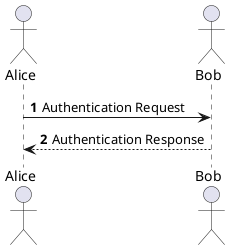
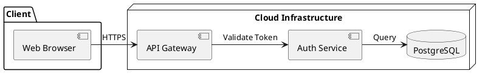
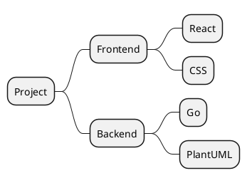

# Markdown + PlantUML Live Studio

A modern, responsive web application that renders **Markdown documents with embedded PlantUML diagrams** in real time.

---

## Background & Problem Solved

In offline-only environments (such as the `dev_tools` Chrome extension), PlantUML cannot easily be rendered because PlantUML requires either:
1. A Java/WASM runtime (which is heavy and difficult to bundle in a lightweight extension), or
2. An external rendering server.

**Markdown + PlantUML Live Studio** solves this problem by providing a dedicated browser-based studio that performs client-side raw deflate encoding and fetches crisp SVG/PNG diagrams from a configurable PlantUML server. The default is a local server at `http://localhost:8080`. The official PlantUML server and Kroki remain available as presets.

---

## Features

- ⚡ **Live Real-Time Rendering**: Instant GitHub-flavored Markdown rendering with debounced diagram updates.
- 📐 **PlantUML Vector Rendering**:
  - Automatically identifies ```` ```plantuml ````, ```` ```puml ````, and ```` ```uml ```` code blocks.
  - Supports all diagram types: Sequence, Component/Architecture, Class, Activity, State, Mindmaps (`@startmindmap`), WBS (`@startwbs`), etc.
  - Auto-normalizes code: automatically wraps diagrams with `@startuml ... @enduml` if omitted.
- 🔍 **Interactive Diagram Tools**:
  - **Zoom & Pan Modal**: Inspect large, complex diagrams with mouse drag, wheel zoom, and 1:1 / fit controls.
  - **Copy Source**: One-click copy of PlantUML source code.
  - **Download**: Export diagrams directly as `.svg` or `.png`.
  - **Direct Link**: Open diagrams in the PlantUML web server in a new tab.
- 🎨 **Modern Split-Pane UI**:
  - Draggable splitter with double-click auto-center (50/50).
  - Dark mode and Light mode with automatic system preference detection.
  - Autosaves document content, splitter position, and settings to `localStorage`.
- ⚙️ **Configurable Server Endpoints**:
  - Local PlantUML server (`http://localhost:8080`, the default)
  - Official PlantUML Server (`https://www.plantuml.com/plantuml`)
  - Kroki API (`https://kroki.io`)
  - Any other PlantUML-compatible server
- 💾 **Export & Sharing**:
  - Export to a standalone HTML file with inlined styles and embedded diagrams. A diagram stays linked to its server when that server blocks the browser from reading the image.
  - Export to Markdown file (`.md`).
  - Copy rendered HTML or raw Markdown to clipboard.
  - Print / PDF preview friendly.

---

## Getting Started

### Quick start

The quickest setup uses a public rendering server and does not require Java, Docker, Node.js, or Python:

1. Open `index.html` in a modern web browser.
2. Click the gear icon in the upper-right corner.
3. Select **Official PlantUML server** or **Kroki**, then click **Save Settings**.
4. Start typing Markdown or choose an example from **Load Sample...**.

An internet connection is required, and your diagram source is sent to the selected public server. To keep diagrams on your computer or network, follow the local server instructions below.

### 1. Open the studio

Choose any one of these methods. You do not need to run all three.

#### Open the file directly (zero install)

Double-click `index.html`, or open it from a terminal. On macOS:

```bash
open index.html
```

#### Use Node.js

If Node.js is installed:

```bash
npm install
npm start
```

Then open [http://localhost:3000](http://localhost:3000).

#### Use Python

If Python 3 is installed:

```bash
python3 -m http.server 3000
```

Then visit [http://localhost:3000](http://localhost:3000) in your browser.

### 2. Choose a diagram server

The studio sends encoded diagrams to a PlantUML-compatible rendering server. Choose one of the following options.

#### Local PlantUML server (default)

Use this option when diagrams must stay on your computer or network. The default address is `http://localhost:8080`.

With Docker:

```bash
docker run -d -p 8080:8080 plantuml/plantuml-server:jetty
```

Open [http://localhost:8080](http://localhost:8080) to confirm that the server is running. No studio setting changes are required.

Alternatively, download `plantuml.jar` from [plantuml.com/download](https://plantuml.com/download) and start PicoWeb:

```bash
java -jar plantuml.jar -picoweb:8080
```

PicoWeb serves diagrams under `/plantuml`. In Settings:

- Choose **Custom server**.
- Set the address to `http://localhost:8080/plantuml`.
- Set the server type to **PlantUML server**.

The Docker image includes Graphviz. When using the jar on macOS or Linux, install Graphviz and make `dot` available on your `PATH` for diagram types that use the default Graphviz layout, including component, class, and state diagrams. Sequence diagrams do not need it. Recent Windows PlantUML jars bundle Graphviz.

#### Official PlantUML server

Open Settings and choose **Official PlantUML server**. Nothing needs to run locally, but diagram source is sent to `plantuml.com` and an internet connection is required.

#### Kroki

Open Settings and choose **Kroki**. Nothing needs to run locally, but diagram source is sent to `kroki.io` and an internet connection is required.

### 3. Development

```bash
npm test
npm run lint
npm run check
```

Sample documents live in `samples/`. After editing one, regenerate its runtime catalog:

```bash
npm run samples:sync
```

### Notes on downloads and exports

The preview requests each diagram image directly from the selected server. Saving a diagram or exporting standalone HTML also asks the browser to read the image bytes. If the server blocks that read, the exported file keeps a link to the server instead.

---

## PlantUML Syntax Examples

### 1. Sequence Diagram

````markdown

````

### 2. Component / Architecture Diagram

````markdown

````

### 3. Mindmap

````markdown

````

---

## Directory Structure

```
markdown_plantuml/
├── index.html              # Main application HTML page
├── package.json            # Project metadata and run scripts
├── README.md               # Documentation
├── css/
│   └── style.css           # Modern theme & layout stylesheet
├── js/
│   ├── config.js           # Shared defaults, presets, and storage keys
│   ├── plantuml-encoder.js # Deflate raw + PlantUML 64 / Base64URL encoder
│   ├── renderer.js         # Markdown + PlantUML integration pipeline
│   ├── settings.js         # Settings validation, migration, and dialog
│   ├── stats.js            # Word, character, and diagram counts
│   ├── export.js           # Standalone HTML export
│   ├── samples.js          # Sample catalog generated from samples/*.md
│   ├── splitter.js         # Editor/preview split pane
│   ├── lightbox.js         # Diagram zoom and pan
│   └── app.js              # Application wiring
├── samples/
│   ├── welcome.md          # Comprehensive welcome sample
│   ├── oauth2.md           # OAuth 2.0 PKCE sequence diagram
│   ├── architecture.md     # Cloud microservices architecture
│   ├── mindmap.md          # Architecture mindmap diagram
│   ├── activity.md         # Order processing workflow
│   └── state.md            # Connection state machine
└── vendor/
    ├── marked.min.js       # Fast Markdown parser
    ├── purify.min.js       # DOMPurify sanitizer
    ├── highlight.min.js    # Highlight.js syntax highlighter
    ├── pako.min.js         # Fast deflate library for PlantUML encoding
    ├── github.min.css      # Light code highlighting theme
    └── github-dark.min.css # Dark code highlighting theme
```

---

## License

MIT
