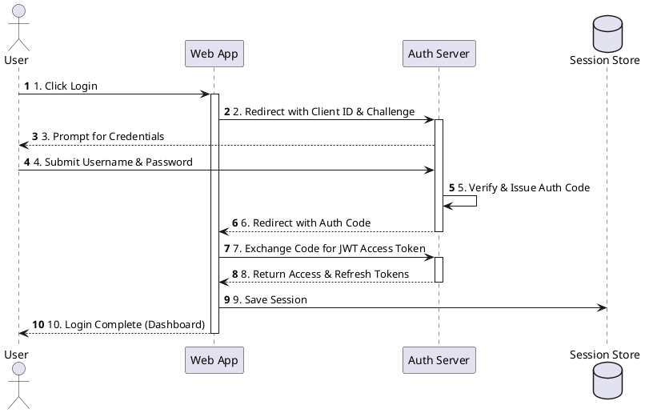
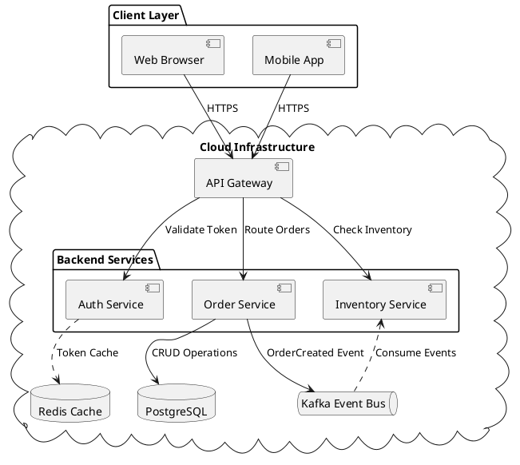
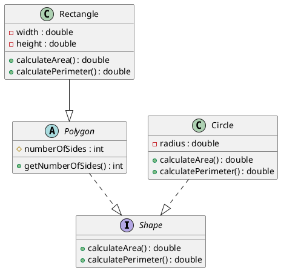
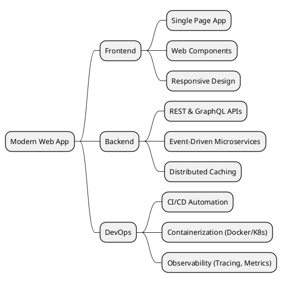

# Markdown & PlantUML Live Studio

Welcome to **Markdown + PlantUML Live Studio**! This application renders standard GitHub-flavored Markdown alongside interactive **PlantUML diagrams**.

---

## 1. Sequence Diagram: Authentication Flow

PlantUML diagrams inside markdown code blocks (```` ```plantuml ```` or ```` ```puml ````) are automatically rendered to vector SVG:



---

## 2. Architecture & Microservices Diagram

Here is a system component diagram demonstrating cloud services:



---

## 3. Class Diagram

Object-oriented design with inheritance and interfaces:



---

## 4. Mindmap / Brainstorming

PlantUML also natively supports mindmaps (`@startmindmap`):



---

## 5. Standard Markdown & Code Highlighting

Tables, lists, and syntax highlighting work seamlessly:

### Feature Matrix

| Feature | Supported | Notes |
| :--- | :---: | :--- |
| **PlantUML Diagrams** | ✅ | Rendered as SVG / PNG via configurable server |
| **Zoom & Pan Modal** | ✅ | Click Zoom on any diagram |
| **Download & Export** | ✅ | Download SVG / PNG, Export standalone HTML |
| **Theme Switching** | ✅ | Light / Dark mode support |
| **GFM Syntax** | ✅ | Tables, Task lists, Strikethrough, Code blocks |

### Code Example (Go)

```go
package main

import (
    "fmt"
    "net/http"
)

func helloHandler(w http.ResponseWriter, r *http.Request) {
    fmt.Fprintf(w, "Hello, PlantUML!")
}

func main() {
    http.HandleFunc("/", helloHandler)
    http.ListenAndServe(":8080", nil)
}
```

### Task Checklist

- [x] Integrate Marked parser
- [x] Support PlantUML 64 deflate encoding
- [x] Zoom and Pan lightbox
- [x] Dark / Light theme toggle
- [x] Export to standalone HTML
